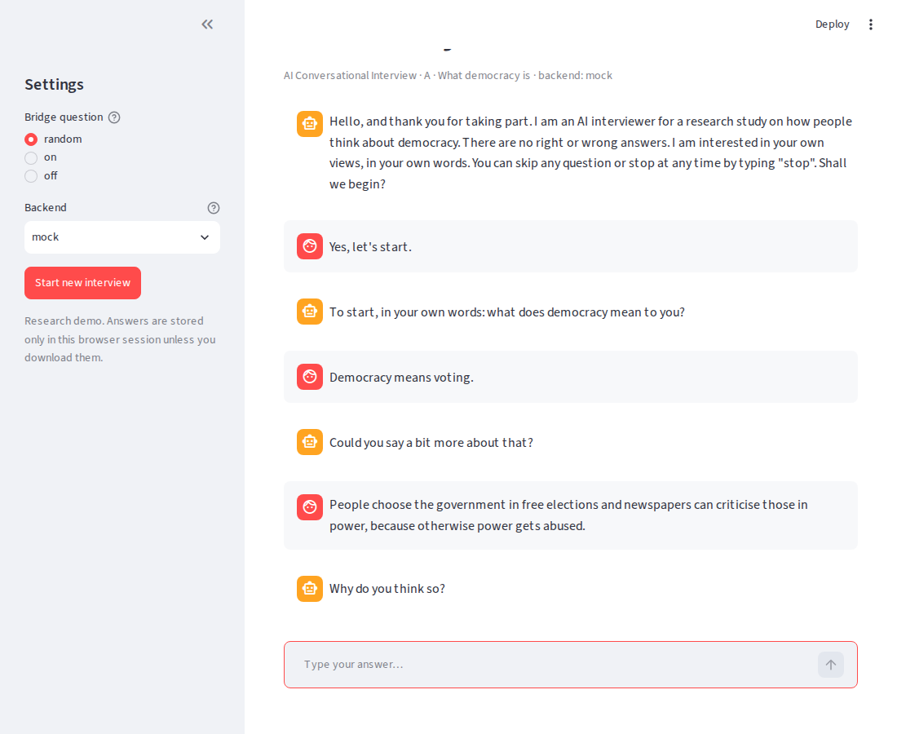
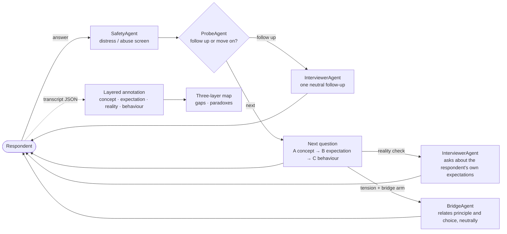
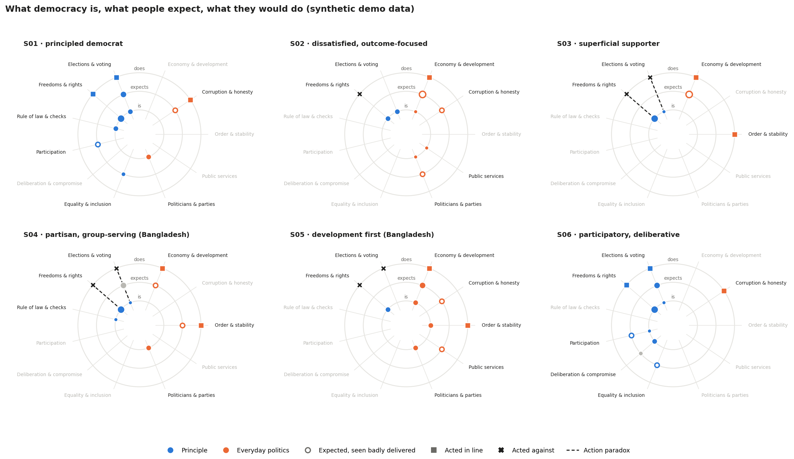
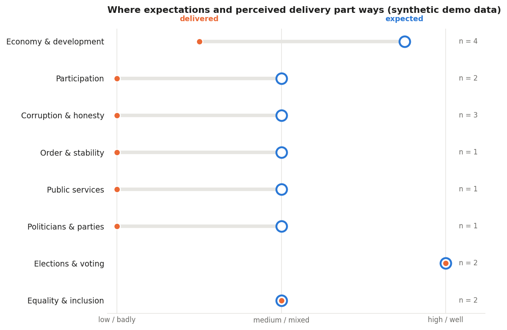
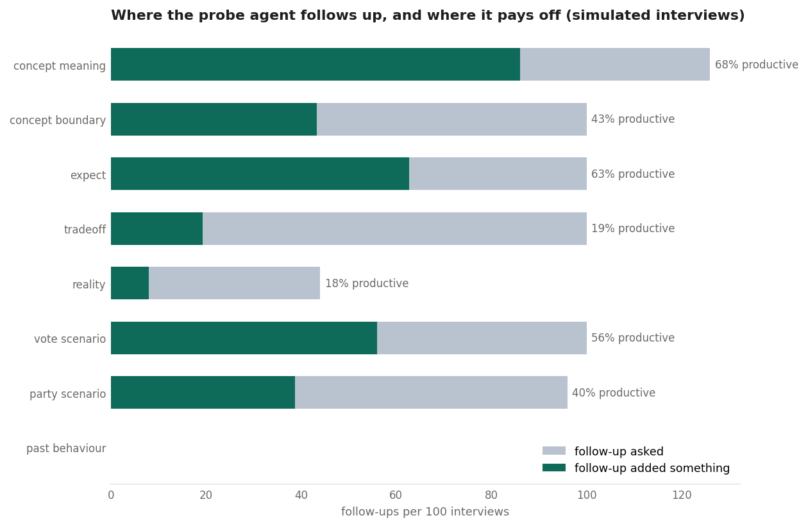
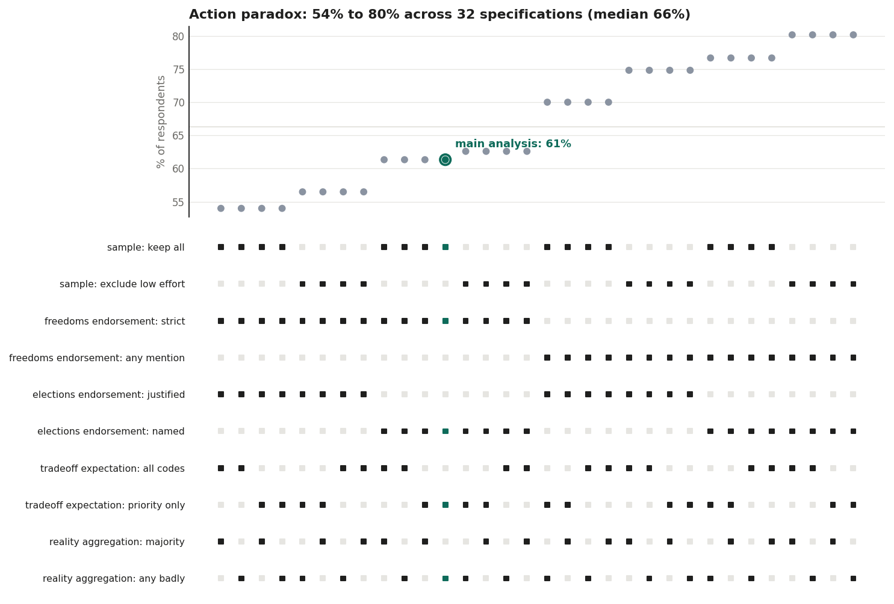

# Democracy Interviewer

**An AI conversational interviewer on democracy, and a pipeline that maps what democracy *is* to people, what they *expect* from it, and what they would *do* when it is tested.**

People say they support democracy, yet many tolerate leaders who undermine it. Closed-ended surveys struggle to show *why*, because the answer options only capture what researchers already expect. This project is a small, working prototype of the alternative: an LLM interviews people, asks adaptive follow-up questions, and the resulting text is coded and mapped.

**▶ Interactive demos (no install): https://YOUR-USERNAME.github.io/democracy-interviewer/** (Journey Map · Agent Trace · Context Lens · Forking Paths Lab)

It is inspired by *AI Conversational Interviewing* (Wuttke et al., 2024, [arXiv:2410.01824](https://doi.org/10.48550/arXiv.2410.01824)) and the Emmy Noether project *Predictably Paradoxical: Mapping the Democratic Mind with AI* at LMU Munich. It is an independent demo and is not affiliated with either.

## The idea: three layers, one codebook

The project asks *"how ordinary people conceptualize democracy, what they expect from it, and how democratic attitudes translate into behavior."* The interview follows those three questions as three modules. Every answer, in every module, is coded with **the same codebook** of 11 considerations (6 principles such as elections or press freedom, 5 everyday concerns such as prices or corruption). Because the codes are shared, the **gaps between layers can be measured**, and those gaps are the three paradoxes in the proposal:

| Module | Asks | Gap it measures |
|---|---|---|
| **A · What democracy is** | own definition; *is a country with elections but a muzzled press still a democracy?* | concept vs. experts → **perception paradox** |
| **B · What it should deliver** | expectations; *fair elections or fast development?*; a reality check written from the respondent's own expectations | expected vs. delivered → **dissatisfaction paradox** |
| **C · What people would do** | a vote between a builder who jails journalists and an honest candidate; what they'd do if *their* party postponed an election; past voting | principle vs. choice → **action paradox** |

When a principle named in module A conflicts with a choice in module C, a **Bridge Agent** can ask one neutral question that puts the two statements side by side. Whether the person *reconciles*, *rationalises* or *revises* is a direct measure of attitude strength. Because such a question could itself shift answers, it runs only in a **randomly assigned arm** (50% by default), so its effect can be estimated.

<p align="center"></p>

## Architecture



Design choices, and why:

- **Small agents instead of one long prompt.** Screening, probing, question writing and bridging each have their own prompt, so they can be tested, swapped and evaluated separately (cf. Chopra & Haaland, 2023).
- **Main questions are asked verbatim.** Everyone gets the same stimulus; the LLM only writes the adaptive parts (follow-ups, the personalised reality check, the bridge question).
- **Hard rules where errors are costly.** Distress is caught by a deterministic rule before any model call; follow-up budgets and the bridge arm are enforced in code.
- **Open-source first.** Any OpenAI-compatible server works: Ollama or vLLM with Llama or Qwen locally (data never leaves the machine), or a hosted API. A `mock` backend runs everything offline.

## Quickstart

```bash
pip install -r requirements.txt

LLM_BACKEND=mock streamlit run app.py          # fully offline
ollama pull llama3.1:8b && streamlit run app.py # open-source model via Ollama (default URL)
LLM_BASE_URL=https://api.openai.com/v1 LLM_MODEL=gpt-4o-mini LLM_API_KEY=sk-... streamlit run app.py

python -m interviewer.cli                       # terminal; bridge arm assigned at random
python -m interviewer.cli --bridge | --no-bridge

python -m analysis.run_analysis                                   # synthetic demo data, keyword baseline
python -m analysis.run_analysis --input data/transcripts --llm    # your interviews, LLM annotation

python data/make_population.py && python -m analysis.multiverse   # decision log -> multiverse (regenerates the synthetic population)

python data/simulate_interviews.py && python -m analysis.agent_report   # agent behaviour

python -m analysis.context_eval                                           # context packs
LLM_BACKEND=mock python -m interviewer.cli --context bangladesh

pytest -q   # 21 tests, incl. the OpenAI-compatible path against a local stub server
```

## Demo results (synthetic data)

> **The six transcripts are hand-written personas, not real respondents** (`data/make_synthetic.py`). Two are set in Bangladesh. They only show that the pipeline works end to end and say nothing about real public opinion.



Each consideration keeps a fixed spoke; the rings are what democracy **is** to the person (inner), what they **expect** (middle; hollow = seen as badly delivered) and what they **do** (outer; square = acted in line, ✕ = acted against). A consistent democrat lines up along the spokes. A dashed spoke is an action paradox.

- **S01 (principled democrat)** lines up: names elections, press freedom and courts, and acts on them. Their discontent is about delivery (corruption, too little say), the critical-citizen pattern.
- **S03 (superficial supporter)** says there is no democracy without a free press, then votes for the builder who jails journalists and accepts a postponed election. Asked the bridge question, they **revise**: *"Maybe I would reconsider my vote."*
- **S04 (partisan, Bangladesh)** shows the same two paradoxes but **rationalises** when bridged: *"In our country some newspapers spread propaganda, so it is necessary to control them for stability."*
- **S05 (development first, Bangladesh)** also votes for the builder, but this is **not** flagged: they called press freedom optional ("newspapers matter less than rice"). The same choice means different things depending on the concept behind it, which is exactly why the layers matter.



The gap chart compares how much people expect each consideration (ring) with how well they see it delivered (dot). In this toy data, most of the gaps are in everyday politics (economy, corruption, services), plus participation between elections. Gaps concentrated in tangible areas are what hypothesis H4 predicts for the dissatisfaction paradox.

The older belief-network view (`figures/belief_networks.png`) and per-respondent metrics (`figures/respondent_metrics.csv`) are still produced.

## What the agents do: traces for one interview and across many

`analysis/agent_trace.py` turns an interview into an ordered **agent trace**: every answer passes the safety agent, is coded, and the probe agent decides to follow up or move on; the interviewer agent writes follow-ups and the reality check; after module C the bridge agent checks for a principle-choice conflict and, in the bridge arm, asks. Interviews run by the engine record the agents' real decisions (action, reason, depth); for the hand-written personas the trace is reconstructed.

To see how the agents behave *before* fieldwork, `data/simulate_interviews.py` runs the real engine against 150 **simulated respondents** (synthetic, built from the personas). `python -m analysis.agent_report` then shows where the probe agent follows up and whether those follow-ups add anything:



With the offline rule agents, follow-ups on the definition of democracy add something two times out of three, while follow-ups on the trade-off and the reality check rarely do (about one in five). That is the kind of evidence needed to decide where probing is worth the respondent's time, given that answers shorten as interviews get longer.

## Context packs: one instrument, many societies

Democracy is understood and lived differently across societies, and an interviewer built around one society's vocabulary will mis-measure the others. Each country therefore gets a **context pack** (`config/contexts/`), Western ones included, so no country is the default:

| Field | Used by | Example (Bangladesh) |
|---|---|---|
| `vignettes` | script | the vote scenario names "your constituency" and "a new bridge"; the construct (outcomes vs. press freedom) stays the same |
| `glossary` | coder (keyword and LLM) | *hartal* → order, *caretaker government* → elections, *load-shedding* → services, *union parishad* → participation |
| `sensitive_topics`, `discomfort_markers`, `reassurance` | engine, probe agent | "I'd rather not say, it's not safe" on the party question → reassure, no follow-up, move on |
| `notes_for_agents`, `probing_style` | probe, interviewer and bridge agents | never ask for or name a party; treat "it depends" as a polite answer and probe with an example |
| `interpretation_guardrails` | analysis and write-up | naming development or stability is a substantive understanding of democracy (Shin 2017), not by itself anti-democratic |

Packs exist for **Bangladesh, India and Germany**. A small hand-labelled check (`python -m analysis.context_eval`) shows what is at stake: without the local vocabulary the coder finds 57% (Bangladesh), 30% (India) and 38% (Germany) of the considerations in answers that use everyday local terms. With the pack it finds all of them, but this is **in-sample**: the glossary and the test answers were written together. The real test is held-out answers coded by independent native coders, which is part of the proposed validation.

## Analytical decisions, made explicit (multiverse)

Building a coding pipeline with an agent means making many small choices along the way. Here they are logged rather than buried: `config/decisions.yaml` lists every fork (who enters the sample, when someone counts as endorsing press freedom or elections, how the trade-off and mixed verdicts are coded, which annotator), with the **main** choice, the alternatives judged **plausible**, background for the decision, the question a **skeptical reviewer** would ask, and options that were **considered but not offered**, so the agent's filtering is visible too.

`analysis/multiverse.py` re-runs the analysis under every combination (32 specifications offline) on a synthetic population of 150 interviews and draws a specification curve:



In this toy data the share of respondents with an action paradox ranges from **54% to 80%** (main analysis 61%), and the expectation gap from 50% to 80% (main 67%). The biggest lever for the action paradox is **how press-freedom endorsement is defined**; for the expectation gap it is **how mixed verdicts are aggregated**. These are exactly the places where theory, not code, has to decide.

## Limitations and next steps

1. **The keyword baseline is crude.** It counts circular reasons as justifications and judges delivery clause by clause. The LLM annotator is meant to fix this, but **both must be validated against human coders** (inter-coder reliability, per-category F1) before any substantive claim.
2. **Scenario realism.** The two behaviour scenarios are stylised. They should be adapted per country and checked against real behaviour where possible (e.g. validated turnout).
3. **The bridge question is an intervention.** It needs ethics review, a pre-registered analysis of the bridge-vs-control arms, and checks that it does not lower data quality in later questions.
4. **Interviewer bias.** LLM interviewers may lead or stereotype; every adaptive question should be scored for leading or judgmental language and compared with human-led interviews.
5. **Not yet implemented:** voice input, multilingual interviews, panel linking over time, embedding-based discovery of considerations outside the codebook.

## Ethics

The interviewer introduces itself as an AI and lets respondents skip questions or type `stop` at any time. It screens for distress with a hard rule and never gives advice. Transcripts are stored locally only. Political attitudes are sensitive data, so a real deployment needs informed consent, ethics approval, secure hosting and de-identification before any data is shared.

## Repository

```
app.py                     Streamlit chat UI (+ "map my democratic belief system")
config/questionnaire.yaml  three modules, dynamic reality check, bridge arm
config/contexts/           context packs (Bangladesh, India, Germany)
config/decisions.yaml      logged analytical decisions (main / plausible / considered)
config/codebook.yaml       11 considerations + markers for boundary, delivery, choices, bridge reactions
interviewer/               llm.py · agents.py (Safety, Probe, Interviewer, Bridge) · engine.py · cli.py
analysis/                  annotate.py (layers + tensions) · context.py · context_eval.py · agent_trace.py · agent_report.py · multiverse.py · layers_viz.py · network.py · run_analysis.py
data/make_synthetic.py     synthetic demo personas -> data/synthetic/
data/make_population.py    synthetic population of 150 for the multiverse
data/simulate_interviews.py  runs the engine against 150 simulated respondents
figures/                   generated figures and metrics
docs/                      GitHub Pages site: project home page + standalone interactive demos
tests/                     pytest suite
```

## Author

**Tansif Anzar**, Machine Learning Consultant, UN Office of Information and Communications Technology · M.Sc. CSE, BUET
[LinkedIn](https://linkedin.com/in/tansif-anzar) · tansifruetcse13@gmail.com

Licence: MIT
